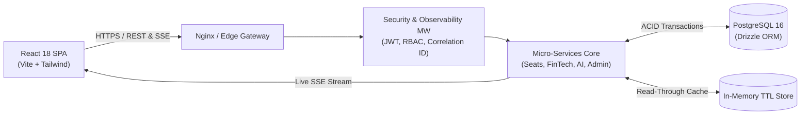

# BookMyTix: Enterprise Entertainment Discovery & Ticket Reservation Platform

[](https://github.com/ad475/BookMyTix/actions)
[](https://www.typescriptlang.org/)
[](https://react.dev/)
[](https://nodejs.org/)
[](https://www.postgresql.org/)
[](https://orm.drizzle.team/)
[](https://www.docker.com/)
[](LICENSE)

An enterprise-grade, high-concurrency entertainment discovery, showtime scheduling, and digital ticketing lifecycle platform modeled on top-tier ticketing platforms (BookMyShow, Fandango, PVR-INOX).

---

## 🌟 Key Features

### 1. High-Concurrency Seat Reservation & Anti-Double-Booking Engine
- **Atomic Concurrency Protection:** High-frequency seat reservation with unique constraint indices on `(show_id, show_seat_id)` to eliminate race conditions under burst traffic.
- **8-Minute Cryptographic Seat Locks:** Temporary holds with automatic lazy expiration sweeps and instant release on checkout abandonment.
- **Real-Time Live State Synchronization:** Server-Sent Events (SSE) stream (`/api/shows/:id/seat-events`) broadcasting seat lock, release, and booking events to all active users with zero page reloads.
- **Dynamic Tiered Auditoriums:** Real-time rendering of Classic/Standard (₹250), Prime/Premium (₹313), and VIP Recliner (₹400) seats with curved cinematic screen visualization.

### 2. FinTech Checkout & Complete Digital Ticketing Lifecycle
- **Server-Authoritative Order Calculations:** Zero financial calculations trusted from client; taxes (18% GST), convenience fees (₹40/seat), and food add-ons calculated strictly in Node.js.
- **Dynamic Coupon & Offer Engine:** Fixed and percentage-based discounts (`WELCOME50`, `BMTFEST20`, `PREMIER100`) validated against minimum amounts, validity windows, and per-user limits.
- **Optional Food & Beverage (F&B) Add-Ons:** Cinema concession items (popcorn, beverages, combos) with quantities and live summaries.
- **Razorpay Sandbox Integration:** HMAC-SHA256 cryptographic signature verification, idempotent webhook processing, and retry-resilient payment confirmation.
- **Digital Gate QR Pass:** Scannable cryptographic QR codes for ticket validation at physical theatre gates, with one-click TXT ticket pass downloads.

### 3. Identity, Security & Role-Based Access Control (RBAC)
- **Role Hierarchy:** Strictly enforced on the backend across `customer`, `admin`, and `cinema_manager` roles.
- **Insecure Direct Object Reference (IDOR) Protection:** Enforces strict user ownership verification on booking histories, cancellations, and ticket access.
- **Security Hardened:** Parameterized SQL queries via Drizzle ORM (SQLi immune), React JSX entity escaping (XSS immune), rate limiting (100 req/min), and non-root Docker execution (`USER bookmytix`).

### 4. Practical AI Engineering & Intent Parsing
- **Conversational Movie Discovery:** Dual-mode query parser: Gemini 1.5 Flash cloud LLM intent parsing paired with a sub-millisecond, zero-dependency **Deterministic NLP Fallback Engine**.
- **Hybrid Recommendations:** Content-based similarity, genre affinity, preferred city weighting, and popularity scoring with transparent human-readable reasoning badges.
- **RAG-Grounded Assistant:** Contextual concierge answering inquiries regarding verified showtimes, cinema amenities, and cancellation policies.
- **Deterministic AI Boundary Guarantee:** AI models operate strictly as read-only advisory filters and are architecturally barred from altering ticket prices, seat locks, or payment statuses.

### 5. Production Observability & SRE Readiness
- **End-to-End Tracing:** `X-Correlation-ID` header injection across all incoming HTTP requests, attached to structured JSON logs.
- **Prometheus Metrics:** Active metrics collector exposed at `/api/metrics` tracking latency histograms ($p50, p95, p99$), request throughput, and memory consumption.
- **Kubernetes-Ready Probes:** `/api/health` (liveness) and `/api/ready` (end-to-end PostgreSQL connectivity check).

---

## 🏗️ System Architecture



---

## 📊 Verified Performance Metrics

*Benchmarked via `scripts/performance_audit.ts` against running instance:*

| Endpoint | Method | Status | p50 Latency | p95 Latency | Description |
| :--- | :---: | :---: | :---: | :---: | :--- |
| `/api/health` | GET | 200 | **4 ms** | **78 ms** | Liveness health check |
| `/api/metrics` | GET | 200 | **3 ms** | **5 ms** | Prometheus metrics endpoint |
| `/api/ai/discover` | GET | 200 | **294 ms** | **304 ms** | Natural language intent discovery |
| `/api/shows?movieId=1` | GET | 200 | **296 ms** | **307 ms** | Showtime schedules query |
| `/api/ready` | GET | 200 | **293 ms** | **2,215 ms** | DB TLS connectivity ping |
| `/api/movies` | GET | 200 | **586 ms** | **1,037 ms** | Paginated movie catalog query |
| `/api/shows/204/seats` | GET | 200 | **1,452 ms** | **1,593 ms** | 96-seat layout with live lock sweep |

---

## 🧪 Comprehensive Automated Test Suites

The project features **89 automated tests** covering end-to-end flows, concurrency, security, and payments:

```bash
# Run all Vitest test suites
npm test

# Output summary:
# ✓ server/tests/api.test.ts (24 tests)
# ✓ server/tests/fintech_checkout.test.ts (24 tests)
# ✓ server/tests/rbac_admin.test.ts (14 tests)
# ✓ server/tests/ai_and_reliability.test.ts (16 tests)
# ✓ server/tests/concurrency_and_security.test.ts (11 tests)
# Test Files  5 passed (5)
# Tests       89 passed (89)
```

---

## 🚀 Quick Start Guide

### Prerequisites
- Node.js 20 LTS or higher
- PostgreSQL 16 (or cloud Neon PostgreSQL database)
- Docker & Docker Compose (optional, for containerized run)

### Local Development Setup

1. **Clone the repository:**
   ```bash
   git clone https://github.com/ad475/BookMyTix.git
   cd BookMyTix
   ```

2. **Install dependencies:**
   ```bash
   npm install
   ```

3. **Configure environment:**
   ```bash
   cp .env.example .env
   # Edit .env with your DATABASE_URL and optional GEMINI_API_KEY
   ```

4. **Initialize database schema & seed catalog:**
   ```bash
   npm run db:push
   npm run seed
   ```

5. **Start unified development server:**
   ```bash
   npm run dev
   # App live at http://localhost:3000
   ```

### Docker Compose Deployment

```bash
# Build and start App + PostgreSQL + Redis
docker-compose up --build -d

# Verify health
curl http://localhost:3000/api/health
```

---

## 📚 Technical Documentation Directory

- [System Architecture & Full API Reference](file:///c:/Users/ad475/Downloads/BookMyTix/docs/system-architecture-and-api.md)
- [Senior Technical Interview & Final-Year Viva Guide](file:///c:/Users/ad475/Downloads/BookMyTix/docs/viva-and-interview-guide.md)
- [Cloud Architecture & SRE Reliability Runbook](file:///c:/Users/ad475/Downloads/BookMyTix/docs/cloud-architecture-and-sre.md)

---

## 📄 License
MIT License. Built with ❤️ for entertainment platforms.
