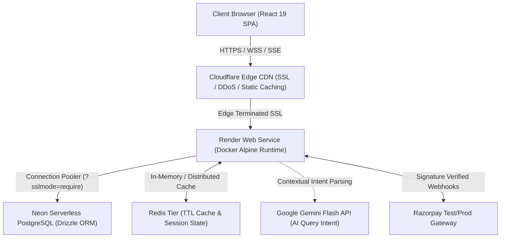
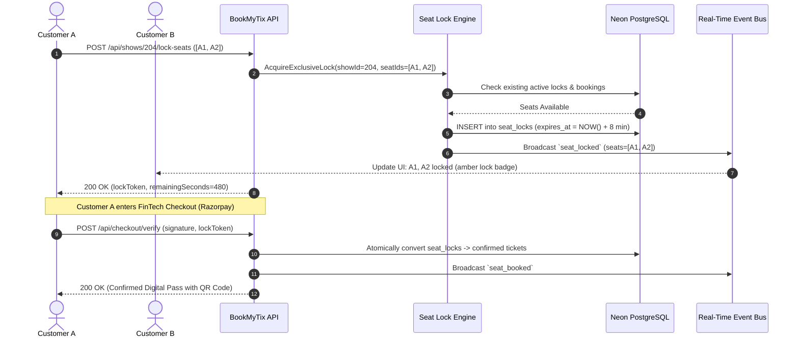

# BookMyTix: Cloud Architecture, SRE & Distributed Reliability Guide

## 1. Executive Summary & Architecture Overview

BookMyTix is an entertainment ticketing platform built with high-concurrency ticket reservations, AI-augmented movie discovery, and fintech payment lifecycles.

---

## 2. Distributed System Components & Boundaries

| Component | Technology | Role & Scalability Strategy |
| :--- | :--- | :--- |
| **Edge & CDN** | Cloudflare Free / Pro | SSL termination, DDoS protection, static asset caching (Brotli/Gzip), HTTP/3. |
| **Compute / API** | Render Web Service / Docker | Containerized Node.js 20 Alpine runtime. Auto-scales horizontally based on CPU & memory triggers. |
| **Database** | Neon Serverless PostgreSQL | Auto-suspends on idle, instant scale-up on traffic spikes. Dedicated PgBouncer pooler endpoint. |
| **Caching Layer** | CacheService (In-Memory + Redis) | Multi-tier TTL cache with prefix invalidation for movie catalog, AI recommendations, and fast queries. |
| **Real-Time Stream** | SSE (`/api/shows/:id/seat-events`) | Lightweight Server-Sent Events with automated 15-second heartbeat packets for seat locks and booking status updates. |
| **AI Subsystem** | Gemini Flash + Fallback NLP | Natural language search parsing and contextual FAQ grounding. **Strict safety boundary: AI cannot alter seats, pricing, payments, or admin permissions.** |

---

## 3. High-Concurrency Seat Locking & Real-Time Sync

Ticket booking systems require strict correctness to prevent double-booking identical seats:

### Deterministic Guardrails
1. **8-Minute Expiry Countdown**: Held seats release automatically if payment fails or user abandons checkout.
2. **Atomic Verification**: Payment signatures are validated with cryptographic HMAC-SHA256 before any database state transition.
3. **Idempotency**: Webhooks and payment callbacks check existing booking statuses before executing side-effects.

---

## 4. Cloud Infrastructure Costs & Free-Tier Optimization

### Estimated Production Monthly Cost Breakdown

| Service | Tier / Plan | Specs | Monthly Cost (Est.) |
| :--- | :--- | :--- | :--- |
| **Render Web Service** | Starter (or Free Hobby) | 512 MB RAM, 0.5 vCPU | \$0 - \$7.00 |
| **Neon PostgreSQL** | Free Serverless Tier | 0.5 GiB storage, auto-suspend | \$0.00 |
| **Cloudflare** | Free Tier | Unlimited bandwidth, global CDN | \$0.00 |
| **Google Gemini Flash** | Free Tier / Pay-as-you-go | 15 RPM free tier, \$0.075 / 1M input tokens | \$0.00 - \$2.00 |
| **Razorpay Gateway** | Standard Sandbox & Prod | 2% per domestic card/UPI transaction | Usage-based |
| **Total Estimated Operating Cost** | | | **\$0.00 - \$9.00 / month** |

### Free-Tier Limitations & Mitigations
- **Render Spin-Down on Idle (Free Tier)**:
  - *Symptom*: First cold request takes 30-50 seconds.
  - *Mitigation*: Scheduled uptime ping every 14 minutes against `/api/health` keeps the container warm during peak cinema hours (10:00 AM – 11:30 PM).
- **Neon Connection Limits**:
  - *Mitigation*: Configured Neon pooled endpoint (`-pooler` subdomain) which utilizes PgBouncer connection multiplexing, preventing socket exhaustion.
- **Gemini Free-Tier Rate Limits (15 RPM)**:
  - *Mitigation*: Built-in deterministic NLP regex & token parser runs as instant fallback with zero external dependency.

---

## 5. Reliability, Disaster Recovery & SRE Runbook

### Recovery Metrics
- **RTO (Recovery Time Objective)**: `< 15 minutes` (Container redeploy via Docker image on Render / AWS ECS).
- **RPO (Recovery Point Objective)**: `< 5 minutes` (Neon Write-Ahead Logging & Point-In-Time-Recovery).

### Database Backup & Point-In-Time-Recovery (PITR)
1. **Neon Serverless Branching**:
   - Zero-copy database branching for staging and pre-migration testing.
   - Any bad migration can be reverted instantly by switching the connection string to a pre-migration snapshot branch.
2. **Automated Logical Snapshots**:
   - Daily `pg_dump` backup archived into encrypted S3-compatible cloud storage (Cloudflare R2).

### Failure Modes & Automated Recovery

| Failure Scenario | Automated SRE Circuit Breaker | Customer Impact |
| :--- | :--- | :--- |
| **Gemini API Down / Throttled** | Automatically switches to `deterministic_nlp` parser. | Zero impact. Discovery and recommendations continue seamlessly. |
| **PostgreSQL Transient Outage** | Readiness probe (`/api/ready`) returns 503; load balancer routes to healthy instance. | Client receives standard retryable error banner. |
| **Payment Webhook Dropped** | Frontend polls `/api/checkout/verify` with idempotent order verification. | Digital ticket issues upon client signature verification. |
| **Client Abandons Checkout** | Expired locks swept lazily on next seat query and via periodic 60s background task. | Seats immediately returned to available pool for other moviegoers. |

---

## 6. Observability & Monitoring Matrix

BookMyTix includes structured telemetry out of the box:

1. **Request Correlation Tracking**:
   - Every request is tagged with an `X-Correlation-ID` header.
   - Propagated through all API logs, database queries, and error traces.
2. **Telemetry Endpoints**:
   - `GET /api/health`: Fast liveness check (memory RSS, uptime, process health).
   - `GET /api/ready`: Readiness check (database ping latency, connection state).
   - `GET /api/metrics`: SRE metrics dashboard (HTTP request volumes, status code buckets `2xx/4xx/5xx`, p50/p95/p99 latency percentiles, cache hit ratios).
3. **Secret Sanitization in Logs**:
   - Custom sanitizer masks JWT tokens, credit card numbers, passwords, and private API keys before outputting JSON log entries.
