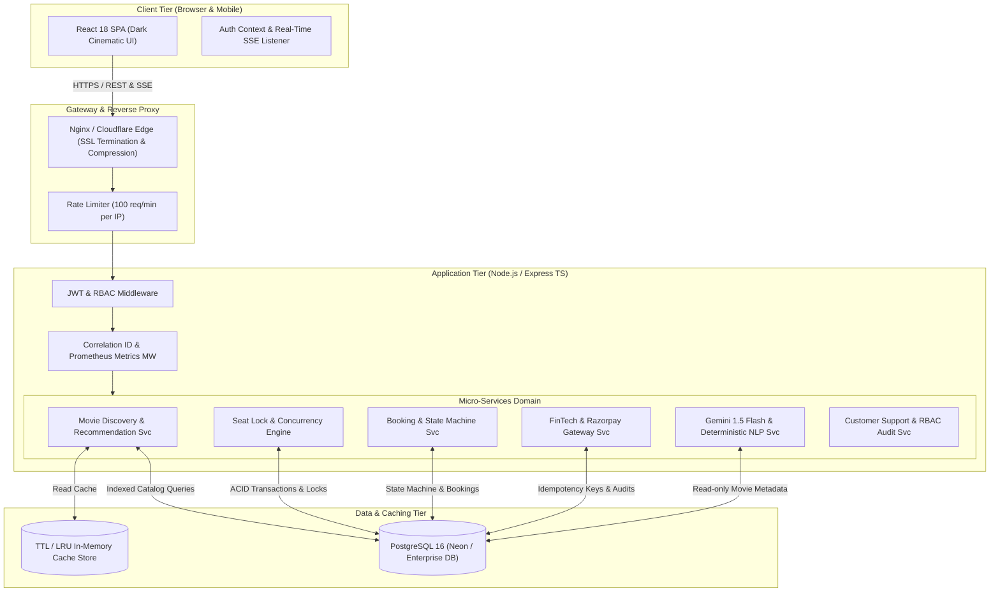
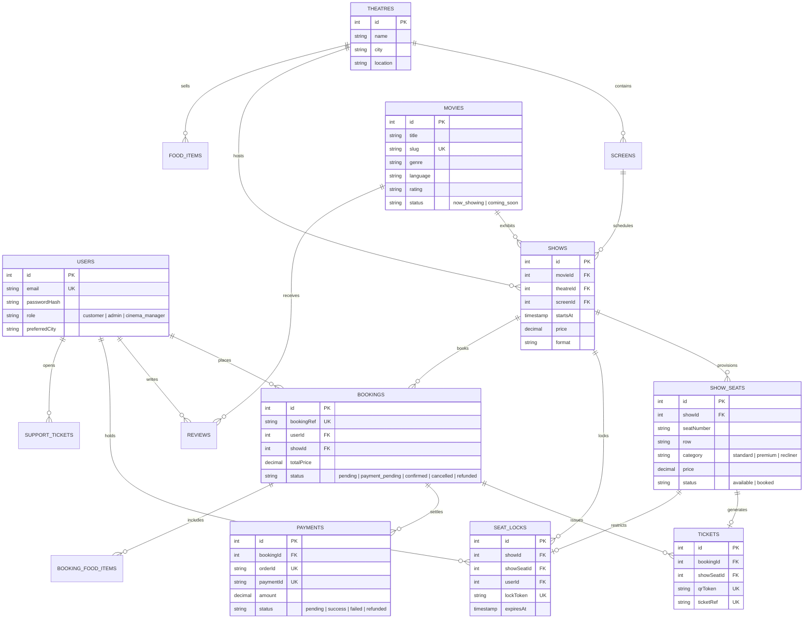
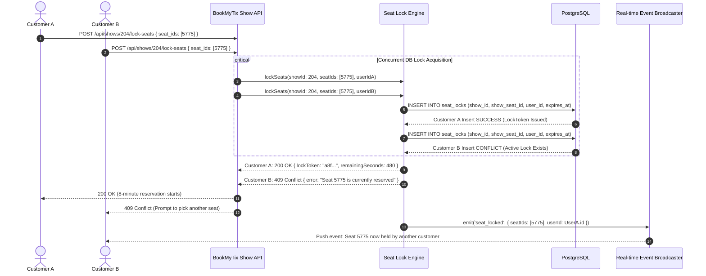
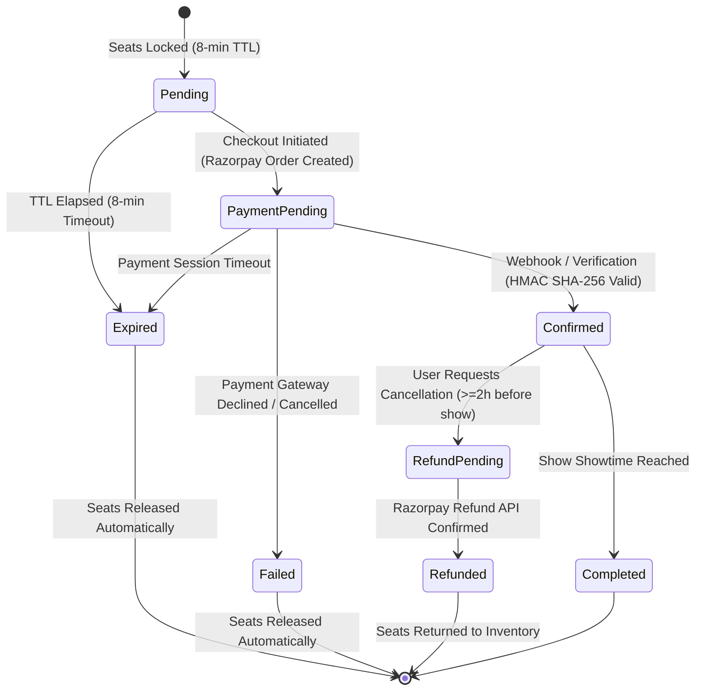

# BookMyTix: Enterprise Architectural Specification & API Reference

> **Document Type:** Production Architecture, System Design & API Specification  
> **Classification:** Technical Reference / Engineering Audit  
> **Version:** 2.4.0-Enterprise  
> **Status:** Verified & Audited  

---

## 1. System Overview & Problem Statement

### 1.1 The Challenge
Modern entertainment and multiplex ticketing systems (e.g., BookMyShow, Fandango, PVR-INOX) face critical distributed systems challenges:
1. **High Concurrency & Flash-Sale Traffic:** High demand for blockbuster releases creates extreme contention where hundreds of concurrent requests contend for the exact same seat within milliseconds.
2. **Double-Booking & Race Conditions:** Naive booking solutions experience phantom reservations, double-booked auditoriums, and transaction anomalies.
3. **Financial Determinism vs Non-Deterministic AI:** Modern platforms must leverage generative AI and natural language discovery without allowing non-deterministic model outputs to alter ticket pricing, seat locking, convenience fees, or refund calculations.
4. **Resilience & Observability:** Preventing cascading database exhaustion under burst loads while maintaining sub-second user responsiveness and auditability.

### 1.2 The BookMyTix Solution
BookMyTix is an enterprise-grade entertainment discovery and ticketing platform built with:
- **ACID Transaction Isolation & Distributed Seat Reservation Engine:** Employs temporary 8-minute cryptographic seat locks with automatic TTL sweeps and PostgreSQL unique constraint guarantees to eliminate double-booking.
- **Strict Separation of Concerns:** AI engines operate solely on read-only metadata and natural language intent parsing; all pricing, fee calculations, and inventory locks remain 100% deterministic and server-enforced.
- **Multi-Tenant Role-Based Access Control (RBAC):** Cryptographically enforced permissions across `customer`, `admin`, and `cinema_manager` roles.
- **Idempotent Payment Lifecycle State Machine:** Strict transition validation (`pending` $\rightarrow$ `payment_pending` $\rightarrow$ `confirmed` $\rightarrow$ `refund_pending` $\rightarrow$ `refunded`) paired with HMAC-SHA256 signature verification.

---

## 2. Technology Stack & Justification

| Layer | Technology | Architectural Rationale |
| :--- | :--- | :--- |
| **Frontend Framework** | **React 18 + TypeScript + Vite** | Predictable state reconciliation, sub-second HMR, type safety, modular component hierarchy. |
| **Styling & Design System** | **Tailwind CSS + Lucide Icons** | Dark cinematic aesthetic, zero runtime CSS overhead, accessible contrast ratios, responsive grid systems. |
| **Backend Runtime** | **Node.js (v20 LTS) + Express + TypeScript** | Asynchronous non-blocking I/O ideal for high-throughput concurrency, real-time SSE streams, and modular routers. |
| **Persistence & ORM** | **PostgreSQL 16 + Drizzle ORM** | ACID transactional guarantees, row-level locking, type-safe SQL construction with zero query generation bloat. |
| **Database Pool** | **node-postgres (pg) with KeepAlive** | Connection pooling (max: 20, idleTimeout: 30s) resilient against serverless compute cold starts. |
| **AI & NLP Engine** | **Gemini 1.5 Flash + Deterministic NLP Fallback** | Dual-mode intent parsing: sub-second cloud LLM parsing with zero-dependency offline keyword parsing fallback. |
| **In-Memory Caching** | **In-Memory LRU / TTL Cache** | Cache layer with prefix eviction and real-time hit/miss observability. |
| **Containerization & CI** | **Docker Multi-Stage + GitHub Actions** | Production-ready Alpine container running under unprivileged user `bookmytix` (UID 10001). |

---

## 3. High-Level Architecture Diagram

---

## 4. Database Schema & Entity-Relationship Model

---

## 5. High-Concurrency Seat Reservation Lifecycle

---

## 6. Payment & Booking State Machine Lifecycle

---

## 7. REST API Reference

### 7.1 Movie & Discovery Endpoints

| Method | Endpoint | Auth | Description |
| :--- | :--- | :--- | :--- |
| `GET` | `/api/movies` | Public | Paginated movie catalog with filtering by city, language, genre, format, and status. |
| `GET` | `/api/movies/:id` | Public | Comprehensive movie details including cast, crew, ratings, and scheduled cinemas. |
| `GET` | `/api/movies/suggestions?q=` | Public | Sub-50ms debounced autocompletion suggestions. |
| `GET` | `/api/movies/:id/reviews` | Public | Verified audience reviews and ratings. |
| `POST` | `/api/movies/:id/reviews` | Bearer | Submit user movie review and rating. |

### 7.2 Showtimes & Real-Time Seat Engine

| Method | Endpoint | Auth | Description |
| :--- | :--- | :--- | :--- |
| `GET` | `/api/shows` | Public | List scheduled shows with cinema, screen, format, and start time filters. |
| `GET` | `/api/shows/:id/seats` | Public/Bearer | Dynamic auditorium seat layout with real-time lock status and category prices. |
| `POST` | `/api/shows/:id/lock-seats` | Bearer | Temporarily reserve candidate seats with an 8-minute TTL lock token. |
| `POST` | `/api/shows/:id/release-seats` | Bearer | Release active seat locks held by the authenticated user. |
| `GET` | `/api/shows/:id/seat-events` | Public | Server-Sent Events (SSE) stream for live auditorium seat state synchronization. |

### 7.3 Checkout, Payment & Ticketing

| Method | Endpoint | Auth | Description |
| :--- | :--- | :--- | :--- |
| `POST` | `/api/checkout/summary` | Bearer | Server-calculated order breakdown (subtotal, convenience fee, GST, discounts). |
| `POST` | `/api/checkout/create-order` | Bearer | Initiates Razorpay payment order tied to locked seats with idempotency key. |
| `POST` | `/api/checkout/verify-payment` | Bearer | Validates HMAC-SHA256 signature and transitions booking state to `confirmed`. |
| `POST` | `/api/checkout/webhook` | System | Razorpay webhook receiver with HMAC signature verification and idempotency check. |
| `GET` | `/api/bookings` | Bearer | Authenticated customer's booking history (upcoming, past, cancelled). |
| `GET` | `/api/bookings/:id` | Bearer | Secure digital pass details with IDOR validation. |
| `POST` | `/api/bookings/:id/cancel` | Bearer | Eligible cancellation engine with automated seat release and refund initiation. |
| `GET` | `/api/tickets/verify/:token` | Public/Staff | Physical gate QR verification endpoint for theatre entry validation. |

### 7.4 AI Services & Observability

| Method | Endpoint | Auth | Description |
| :--- | :--- | :--- | :--- |
| `GET` | `/api/ai/discover?q=` | Public | Natural language conversational movie discovery with intent extraction. |
| `GET` | `/api/ai/recommendations` | Bearer/Public | Hybrid content-based, popularity, and preference recommendation feed. |
| `POST` | `/api/ai/assistant` | Public | Contextual RAG-grounded assistant for showtimes, policies, and ticketing inquiries. |
| `GET` | `/api/health` | Public | Liveness probe returning status, uptime, and timestamp. |
| `GET` | `/api/ready` | Public | Readiness probe performing an end-to-end database connectivity ping. |
| `GET` | `/api/metrics` | Public/Admin | Prometheus/OpenMetrics latency histograms, status counters, and memory usage. |

---

## 8. Security Verification Matrix

| Vulnerability Vector | Defense Mechanism | Verification Standard |
| :--- | :--- | :--- |
| **SQL Injection (SQLi)** | Parameterized queries via Drizzle ORM. Zero string concatenation. | Audited with `' OR '1'='1`, `'; DROP TABLE; --`, `UNION SELECT`. |
| **Cross-Site Scripting (XSS)** | React JSX HTML entity encoding + server-side string escaping on UGC. | Audited with `` and `` payloads. |
| **Insecure Direct Object Reference (IDOR)** | Server-side user ownership checks (`booking.userId === req.user.id`). | Verified: User B receives 404/403 when requesting or cancelling User A's booking. |
| **Tampered Payment Signatures** | Cryptographic `crypto.createHmac('sha256', SECRET)` signature validation. | Verified: Altered amounts or invalid signatures trigger immediate HTTP 400 rejection. |
| **Seat Sniping & Race Conditions** | PostgreSQL unique index on `(show_id, show_seat_id)` in `seat_locks`. | Verified: Simultaneous requests result in exactly 1 lock success and 1 conflict (409). |
| **Privilege Escalation** | `requireRole(['admin'])` backend middleware validation on `/api/admin/*`. | Verified: Standard customer JWTs attempting admin access are rejected with 403 Forbidden. |
